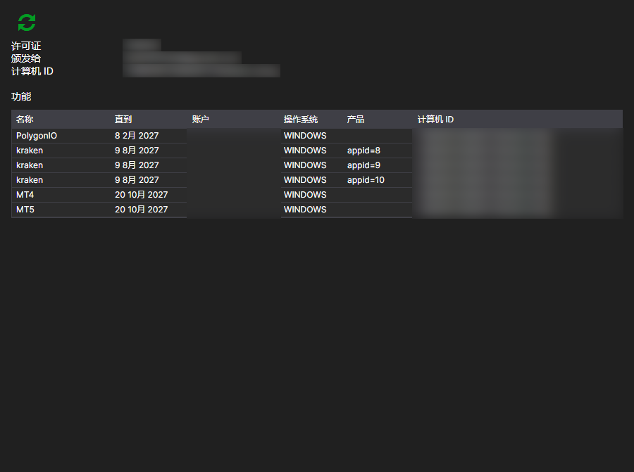

# 许可证

**许可证** 页面可以通过[安装程序](../installer.md)窗口顶部的同名选项卡打开，登录账户后可用。

此页面显示为该账户颁发的许可证及其授予的权限。

- **颁发给** — 许可证的持有人及其绑定的计算机：**计算机 ID** 和 **操作系统**。服务器根据这一绑定判断许可证在当前计算机上是否有效。
- **直到** — 到期日期。
- **产品** — 许可证适用的程序。
- **功能** — 具体允许的内容：交易场所连接、交易品种数量、源代码访问等。

**刷新许可证** 按钮会从服务器重新获取数据。购买或续订后应单击此按钮：[安装程序](../installer.md)在登录时读取许可证，之后在网站上所做的更改不会自动显示在窗口中。

如果没有许可证，页面会给出相应提示。可以在[订阅方案](tariffs.md)页面办理许可证。

## 推荐内容

[订阅方案](tariffs.md)
