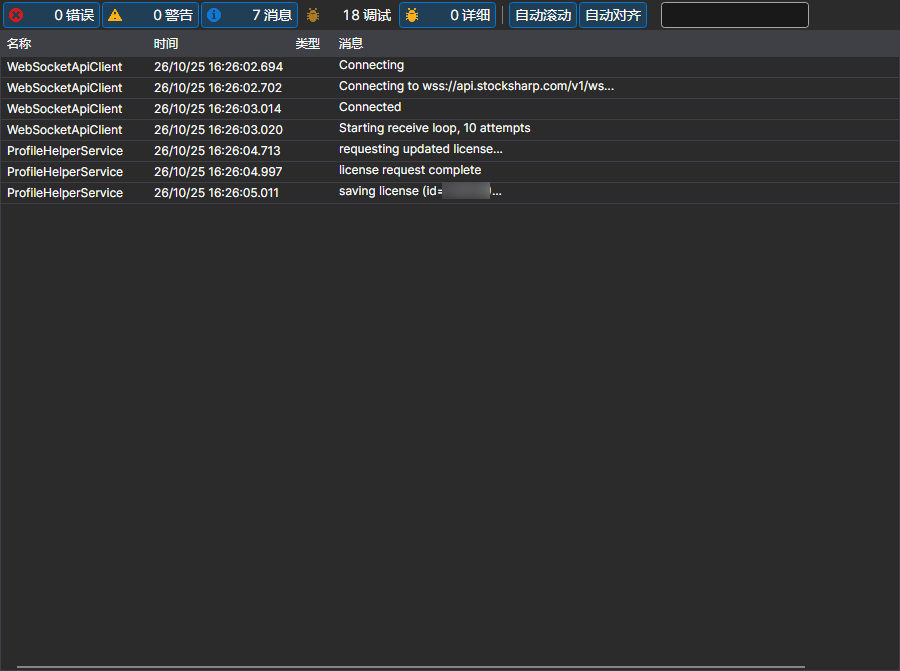

# 日志

**日志** 页面可以通过[安装程序](../installer.md)窗口顶部的同名选项卡打开。

[安装程序](../installer.md)会在此记录其所做的操作：访问了哪个服务器、下载了哪些包、安装到了哪里以及在哪一步停止。如果安装或更新以错误结束，应首先查看此处。

每条记录包含时间、级别（错误、警告、消息）和文本。日志的详细程度由[设置](settings.md)页面上的 **日志记录** 参数决定：联系技术支持时，应提高该级别并重复失败的操作，这样日志中就会记录原因，而不仅仅是出错这一事实。

## 推荐内容

[设置](settings.md)
