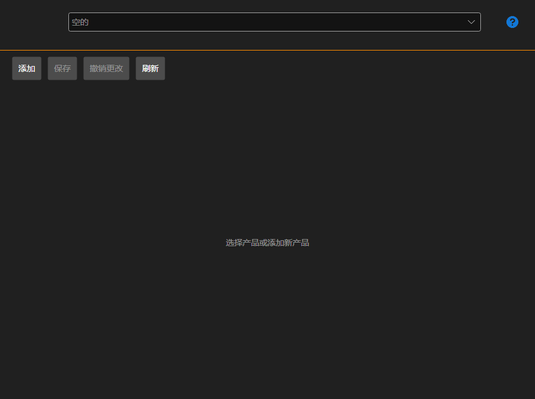

# 我的产品

**我的产品** 页面可以通过[安装程序](../installer.md)窗口顶部的同名选项卡打开，登录账户后可用。

此页面供自行在[商店](https://stocksharp.com/zh/store/)中发布产品（机器人、指标、连接器）的用户使用。购买者不需要此页面：安装和更新请参阅[安装和卸载应用程序](install_and_remove_apps.md)和[更新应用程序](update_apps.md)。

## 产品卡片

在顶部列表中选择产品；**添加** 按钮用于新建产品。

- **名称** 和 **描述** — 购买者在商店中看到的内容。
- **Nuget 包标识符** — 包以此名称发布到 NuGet。旁边会显示完整的包名。
- **内容类型** 和 **产品访问控制** — 产品的类型及其适用范围。
- **类别** — 产品会显示在商店的哪些分区中。
- **链接** 和 **源代码** — 文档链接和源代码链接，均为可选项。
- **图标** — 通过按钮选择；购买者的[安装程序](../installer.md)列表中也会显示此图标。

## 价格

价格单独设置：一次性（**终身**）、**每月** 和 **年度**，以及续订价格。未填写的价格表示不提供该购买方式。

## 访问

用户列表用于指定除商店之外还有哪些人可以看到该产品：通过搜索找到用户并将其添加。例如，可以通过这种方式在团队内部分配访问权限。

## 保存和发布

**保存** 用于保存更改，**撤销更改** 用于恢复到上次保存的状态，**刷新** 用于从服务器重新读取列表。

**发布** 会将产品提交审核。审核通过之前，页面会显示产品尚未获批准，底部的错误列表会列出需要填写或修正的内容；只要该列表不为空，就无法发布。

## 推荐内容

[许可证](licenses.md)
