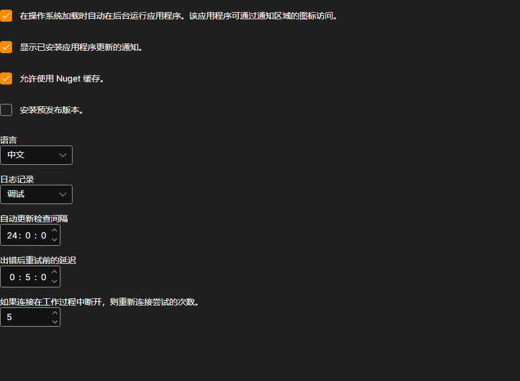

# 设置

**设置** 页面可以通过[安装程序](../installer.md)窗口顶部的同名选项卡打开。

## 可以在此修改的内容

- **在操作系统加载时自动在后台运行应用程序。** [安装程序](../installer.md)会随 Windows 一起启动并驻留在通知区域中，需要从那里将其关闭：单击窗口中的叉号不会退出程序。
- **显示已安装应用程序更新的通知。** 如果不勾选，[安装程序](../installer.md)仍会检查更新，但不会提示：只能在应用程序页面上了解更新情况。具体效果请参阅[更新应用程序](update_apps.md)。
- **允许使用 Nuget 缓存。** 本机上已下载的包会从磁盘读取，而不是从网络下载。这可以加快重新安装；如果需要确保重新获取包，请关闭此选项。
- **安装预发布版本。** 除常规版本外，还会提供预发布版本。只有在清楚自己为什么需要尚未正式发布的版本时，才应启用此选项。
- **语言。** [安装程序](../installer.md)本身的界面语言。
- **日志记录。** 日志的详细程度。记录可以在[日志](logs.md)页面查看；联系技术支持时，详细的日志级别有助于更快找到原因。
- **自动更新检查间隔。** [安装程序](../installer.md)向服务器查询新版本的频率，单位为小时。
- **出错后重试前的延迟。** 重试失败的下载之前等待的时间，单位为分钟。
- **如果连接在工作过程中断开，则重新连接尝试的次数。** [安装程序](../installer.md)在报告错误之前尝试继续下载包的次数。

更改会立即生效并保存，没有单独的保存按钮。

## 推荐内容

[日志](logs.md)
