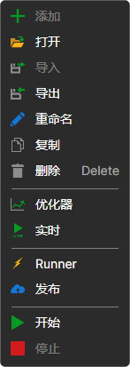

# 从 Designer 导出

**Runner** 可以运行在 [Designer](../designer.md) 中创建的策略。这是配置 **Runner** 最方便的方式，因为所有设置都通过图形界面完成。

要从 [Designer](../designer.md) 导出策略：

- 在树形列表中选择所需策略，单击鼠标右键，然后选择 **Runner** 菜单项：

  

- 在打开的窗口中，选择需要导出到 **Runner** 的连接类型，并设置通过 [Telegram](../telegram_services.md) 管理策略所需的参数：

  

  **警报** 复选框用于启用向其下方所选 Telegram 频道发送交易进度消息。**机器人** 复选框允许通过 Telegram 机器人管理策略（账户中有机器人时可用），其下方的 **委托**、**成交**、**持仓** 和 **股权** 复选框用于选择机器人发送该策略的哪些信息。

以下文件将复制到选定的导出目录：

- connector.json — 包含连接设置的文件。
- params.json — 包含策略参数的文件。
- start.bat — 已写入命令行的 bat 文件，用于快速启动 **Runner**。
- strategy.json — 包含策略的文件。
- connector.json — 包含连接设置的文件。
- telegram.json — 包含 [Telegram](../telegram_services.md) 集成设置的文件。
