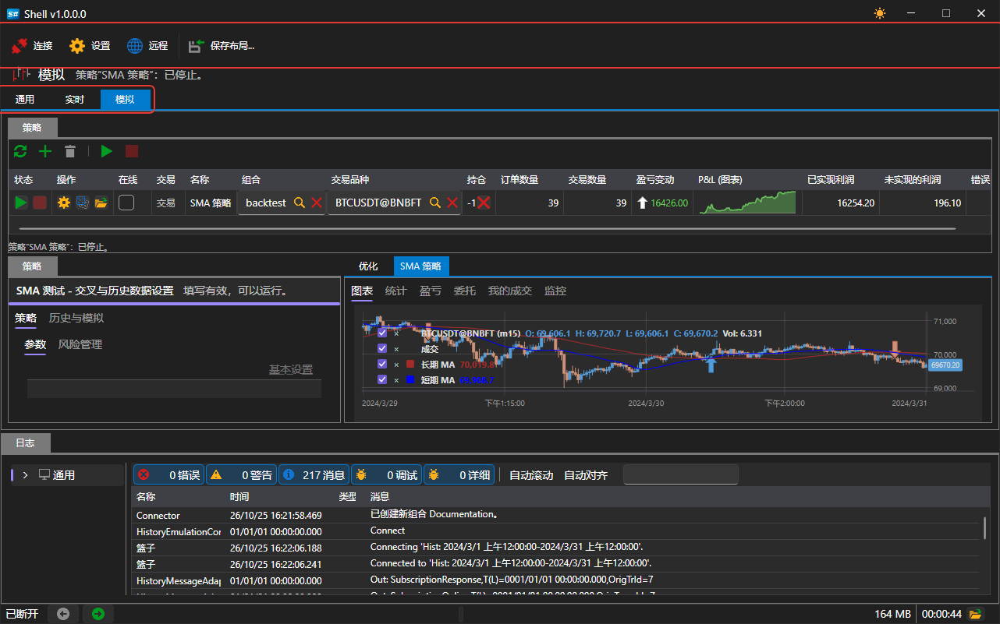
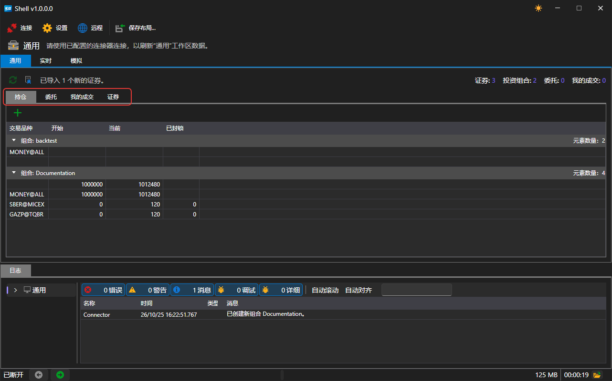
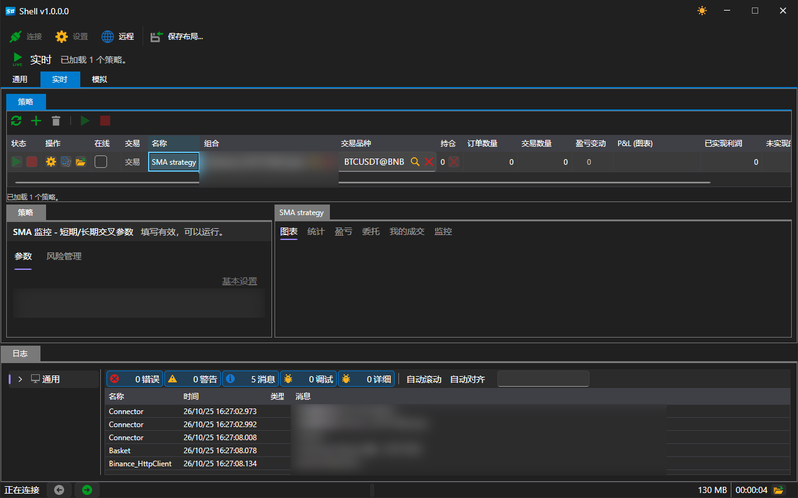
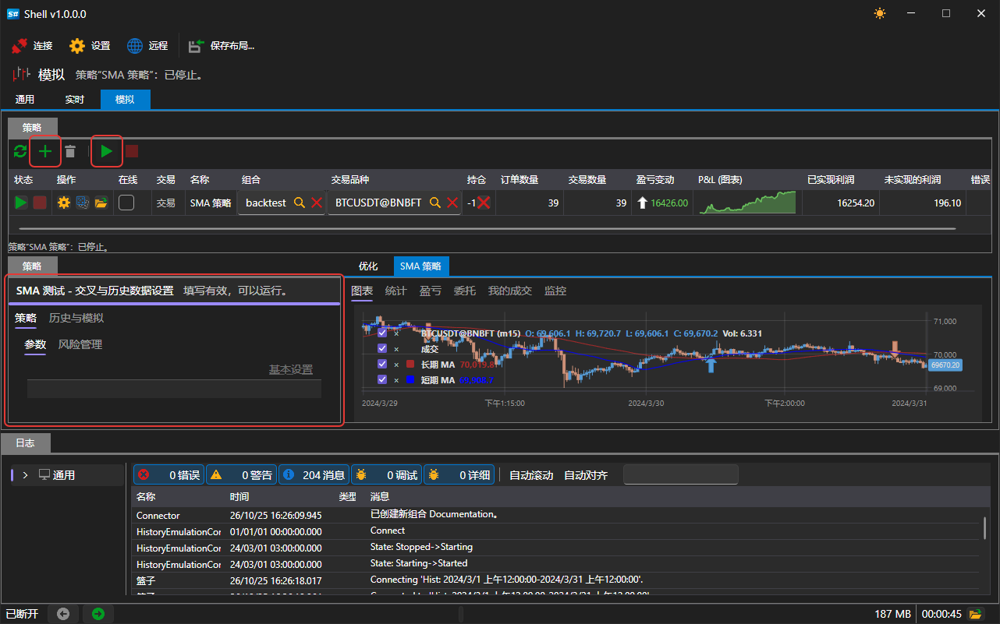

# 快速入门

[Shell](../shell.md) 是 [C\#](https://en.wikipedia.org/wiki/C_Sharp_(programming_language)) 源代码，可以在 Visual Studio、Rider 或任何其他开发环境中打开，并像普通应用程序一样运行：

```
dotnet run --project Shell.Avalonia/Shell.Avalonia/Shell.Avalonia.csproj
```

无需预先配置：项目可以直接运行，并立即使用自带的策略工作。

## 主窗口

启动后会打开类似以下内容的窗口：



左侧是工作区列表，应用程序在这些工作区之间切换。顶部是命令栏：连接设置按钮、**连接** 按钮以及保存当前面板布局的按钮。底部是显示当前连接状态的状态栏。

Shell 写入的所有内容（连接设置、窗口布局、策略列表、导入的 Designer 方案以及本地行情存储）都保存在可执行文件旁边的 `Data` 文件夹中。

## 连接

打开连接设置并选择所需的连接器。有关连接配置方法，请参阅[连接设置](connections_settings.md)。

然后单击 **连接**。连接状态显示在状态栏中以及该按钮旁边。

连接成功后，[常规](user_interface/common.md)选项卡中会显示通过连接接收到的投资组合、交易品种、订单和自有成交。



## 实盘中的策略

打开[实盘](user_interface/real_time.md)选项卡。



单击 **添加**，然后在打开的窗口中选择策略。


策略会显示在 **策略** 表格中，其参数显示在左侧的 **策略** 面板中。填写 **交易品种**、**组合**、数量以及策略本身的参数，然后单击 **开始**。

在建立连接之前，该区域中的添加和启动按钮不可用，表格下方的提示会说明这一点。

## 历史数据上的策略

在[模拟](user_interface/emulation.md)选项卡上执行同样的操作，策略将在历史数据上运行，而不是用于交易。



这不需要连接：每次运行都通过自己的模拟连接器从磁盘读取历史数据。

## 推荐内容

[常规](user_interface/common.md)

[实盘](user_interface/real_time.md)

[模拟](user_interface/emulation.md)
