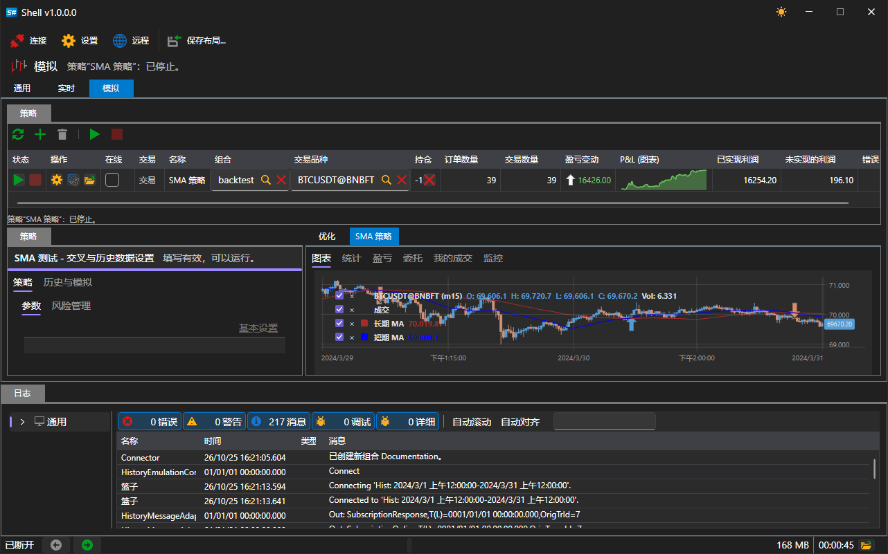

# 远程控制

[Shell](../shell.md) 可以将其策略交由网站管理：正在运行的程序会注册为您账户下的应用程序，向网站报告每个策略的状态，并执行从网站发来的命令。[Hydra](../hydra.md) 和 [Designer](../designer.md) 中的远程控制采用相同的方式，因此 [Telegram 机器人](../telegram_services/control_panel.md)中的程序列表和控制按钮对这三个程序都是一样的。

## 启用

主窗口的命令栏中有 **远程** 开关。

开关关闭时，[Shell](../shell.md) 不会连接任何地方，也不会出现在网站上。开启状态会被记住，并在下次启动程序时恢复。

只有当程序在 StockSharp 账户下运行且网站可以访问时，该开关才会起作用。未登录账户时，开启开关不会产生任何效果：不会打开连接，也不会在网站上注册应用程序。

## 可以远程使用的内容

可以远程使用[模拟](user_interface/emulation.md)区域中的策略，即在历史数据上运行的策略。[实盘](user_interface/real_time.md)区域的策略有意不开放远程使用：它们使用真实资金交易，只能在计算机前亲自启动。脚本使用的进程间通信协议也划定了同样的界限。

单个策略不会自动出现在网站上，只有在其设置中允许时才会出现。在[模拟](user_interface/emulation.md)区域中打开策略，在其设置中找到 **远程** 组：

| 设置 | 设置内容 |
|---|---|
| **已启用** | 网站是否能看到并管理该策略 |
| **通知** | 接收其消息的频道；如果未选择频道，则使用账户的频道 |
| **日志级别** | 从哪个级别开始将消息发送到频道 |

频道取自账户，因此登录后才会显示频道列表。[Telegram](../telegram_services.md) 频道的设置请参阅[授权](../telegram_services/authorization.md)。

## 命令

从网站或机器人发来的命令分为两类：针对整个程序的命令和针对单个策略的命令。

| 命令 | 作用 |
|---|---|
| 针对策略的 **开始** | 如果运行已停止或因错误结束，则启动运行 |
| 针对策略的 **停止** | 停止正在进行的运行 |
| 不指定策略的 **开始** / **停止** | 同时对所有允许远程控制的策略执行相同操作 |
| **启用** / **禁用** 交易 | 将策略切换到完全交易模式，或禁止其交易；当前运行会立即响应 |
| 针对程序的 **停止** | 关闭 [Shell](../shell.md) |
| 程序 **重启** | 关闭 [Shell](../shell.md) 并重新启动 |

发给不允许远程控制的策略的命令会被忽略。

## 发送到网站的内容

- 程序本身的状态：窗口打开时为运行中，窗口关闭时为已停止。
- 每个允许远程控制的策略的状态：每次发生变化时发送。
- 策略的消息：从所选级别开始发送到所选频道。相同的消息不会重复发送。

## 推荐内容

[控制面板](../telegram_services/control_panel.md)

[模拟](user_interface/emulation.md)
