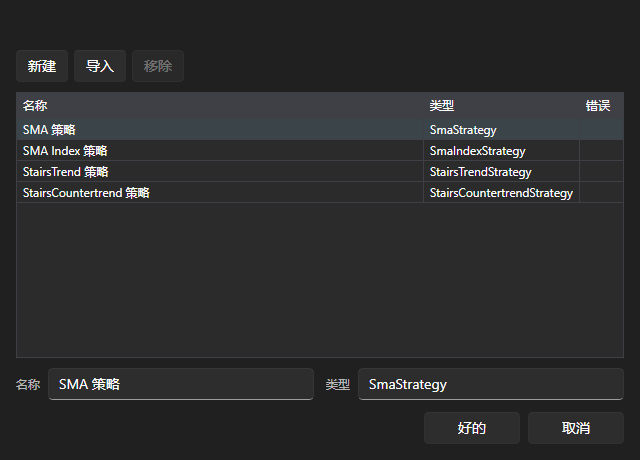

# 运行 Designer 策略

[Shell](../shell.md) 可以运行在 [Designer](../designer.md) 中构建并通过[导出](../designer/export_import/export.md)功能导出的策略。为此无需编写代码：策略图由与 Designer 相同的引擎执行。

## 导入

打开[实盘](user_interface/real_time.md)或[模拟](user_interface/emulation.md)区域，单击 **添加**，然后在打开的窗口中单击 **导入**。

选择从 Designer 导出的策略图文件。它会以在 Designer 中的名称显示在列表中，位于自带策略旁边。列表旁边会显示导入结果：策略图已导入、导入已取消，或导入失败及其原因。

导入的策略图保存在应用程序旁边的 `Data` 文件夹中，重新启动后仍会保留在列表中。

## 运行

之后，使用策略图的方式与使用自带策略相同：选择它，单击 **好的**，在 **策略** 面板上填写交易品种、投资组合、数量和策略图参数，然后单击 **开始**。

在[模拟](user_interface/emulation.md)区域中，策略图会在历史数据上运行，并像其他任何策略一样提供统计信息、图表以及订单和成交列表。

## 推荐内容

[创建策略](create_strategy.md)

[实盘](user_interface/real_time.md)
