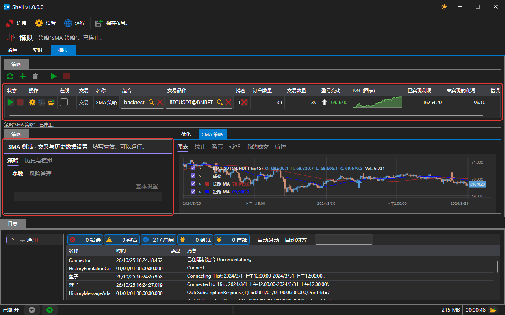
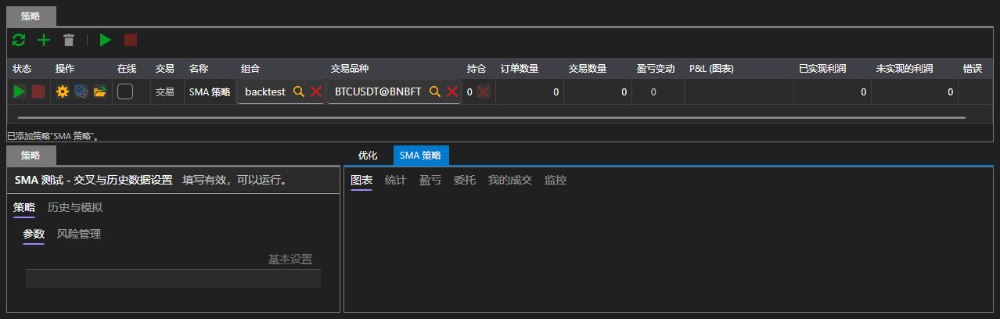
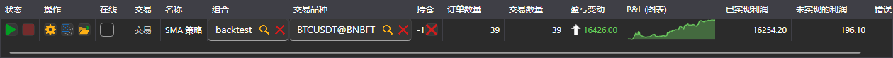
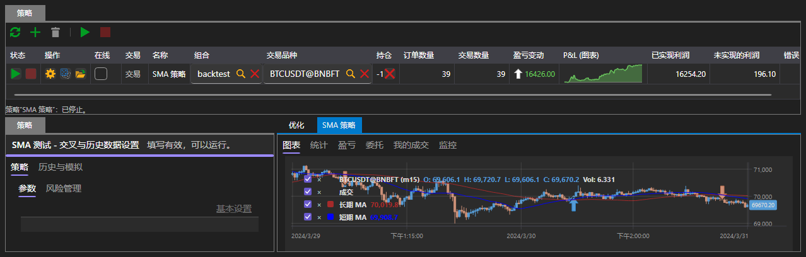
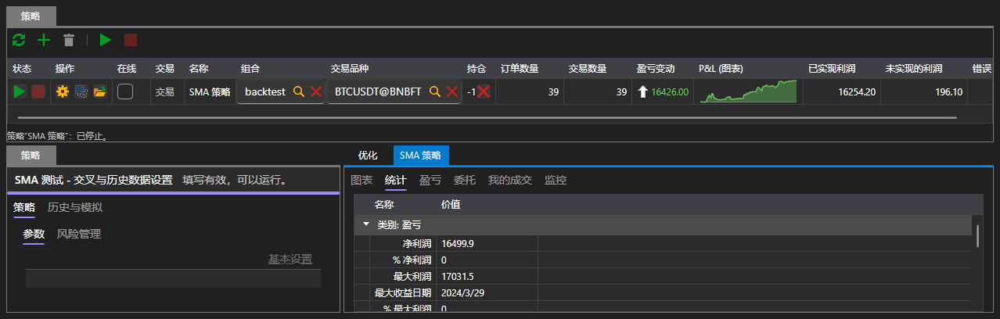
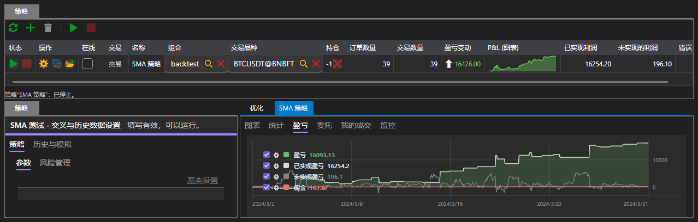
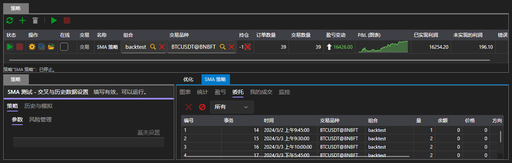
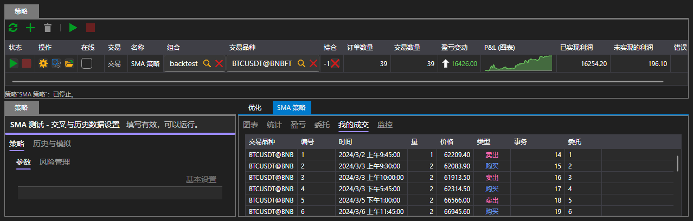

# 模拟

**模拟** 选项卡在历史数据上运行策略。这不需要连接：每次运行都通过自己的模拟连接器从磁盘读取历史数据。

该区域的结构与[实盘](real_time.md)相同：顶部是带按钮的 **策略** 表格，左侧是所选策略的面板，右侧是包含运行产生的全部结果的选项卡。不同之处在于策略面板上有两个选项卡，结果中还有 **优化** 选项卡。

## 运行参数

左侧是 **策略** 面板，在这里设置策略在历史数据上运行所需的全部内容。面板上有两个选项卡：

- **策略** \- 交易品种、投资组合、数量、风险规则以及策略自己的参数；
- **历史与模拟** \- 从哪里获取数据以及如何将数据提供给策略。

| 参数 | 设置内容 |
|---|---|
| **历史数据路径** | 运行时读取K线和逐笔成交的文件夹 |
| **从**、**至** | 运行的第一天和最后一天 |
| **存储格式** | 历史数据在磁盘上的保存形式 |
| **在接触时匹配** | 价格触及订单价格时即执行订单，而不必等待价格穿过 |
| **交易会话状态** | 交易场所不在交易时拒绝订单 |
| **延迟**（毫秒） | 从发送订单到交易场所收到订单之间的延迟 |

默认会填入随平台一起安装的历史数据以及该历史数据覆盖的时间段，因此无需进行任何更改即可启动第一次运行。

如果参数填写有误（未指定路径、时间段的结束早于开始、延迟为负数），表格下方会显示相应消息，运行不会开始。

## 运行

**开始** 按钮会启动运行，面板标题下方的进度条显示已完成的部分。历史数据结束时运行会自动结束；**取消** 按钮可提前停止运行。

运行期间及运行结束后，策略表格中显示的内容与实盘交易时相同：状态、持仓、订单和成交数量以及盈亏。

## 结果

右侧的选项卡用于在运行产生的各项结果之间切换：

| 选项卡 | 显示内容 |
|---|---|
| **图表** | 交易品种的K线以及其上的策略成交 |
| **统计** | 平台计算的全部指标 |
| **盈亏** | 收益曲线 |
| **委托** | 策略提交的全部订单 |
| **我的成交** | 策略的全部成交 |
| **优化** | [参数遍历](optimization.md) |

### 图表

图表上显示运行所用交易品种的K线，以及其上的策略成交标记。

### 统计

统计信息按部分分组：盈亏、成交、订单、延迟。其中包括净利润、以金额和百分比表示的最大回撤、盈利和亏损成交的数量、每笔成交的平均利润、盈利因子，以及夏普、索提诺、卡玛和斯特林比率。

统计中的成交数量少于策略表格中的数量：统计只计算平掉了某些仓位的成交，开立第一个持仓的成交不计入其中。

### 盈亏

收益曲线显示运行期间策略结果的变化情况。

### 订单和成交

**委托** 选项卡显示策略提交的全部内容：每个订单的时间、方向、类型、数量、价格和状态。

**我的成交** 选项卡显示这些订单中已执行的部分。

## 推荐内容

[优化](optimization.md)

[实盘](real_time.md)
