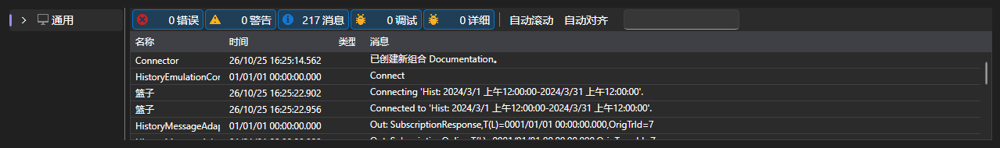

# 日志

**日志** 选项卡显示应用程序报告的全部运行信息：连接、策略、模拟以及外壳本身的消息。

每条记录包含时间、级别（调试、信息、警告、错误）、来源和文本。策略的记录带有策略标识符，因此在多个策略同时运行时可以看出消息来自哪个策略。

表格上方显示累计的错误和警告数量，以及用于清空日志的按钮。表格本身支持按级别筛选记录、按文本搜索、选择列以及导出内容。

如果策略无法启动、不提交订单，或者历史数据运行刚开始就结束，应首先查看日志。

## 推荐内容

[常规](common.md)
