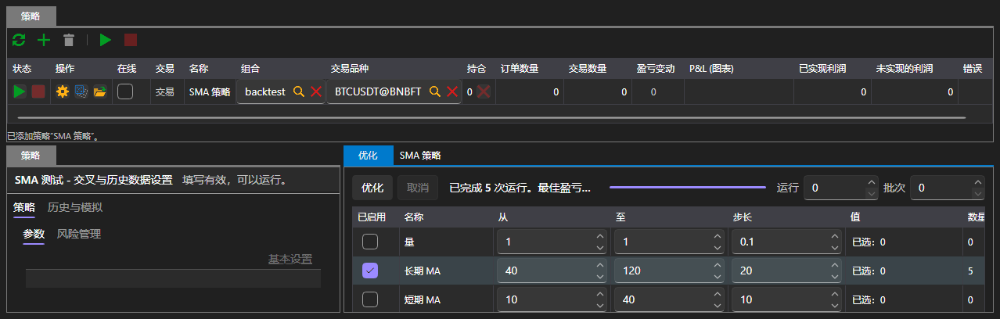

# 优化

**优化** 选项卡通过遍历来选择策略参数：它在相同的历史数据上运行同一策略，运行次数等于参数组合的数量，并显示每次运行的结果。

优化只能在[模拟](emulation.md)区域中使用。[实盘](real_time.md)中没有此选项卡：在实时连接上无法遍历参数。

## 遍历哪些参数

参数表列出了所选策略中可以遍历的参数。只有勾选的参数才会参与遍历；对于勾选的参数，需要设置起始值、结束值和步长。可以输入的内容取决于参数类型：整数参数只能输入整数值，布尔参数只有两个值。

按钮右侧用于设置遍历的范围限制：

| 字段 | 设置内容 |
|---|---|
| **运行** | 最多执行多少次运行；0 表示不限制 |
| **批次** | 同时执行多少次运行 |

组合数量会随着参数的勾选而重新计算，因此可以提前看到遍历的规模。

## 遍历过程

**优化** 按钮启动遍历，**取消** 按钮将其停止。状态行会说明当前的情况：正在规划遍历、正在执行若干次运行、遍历在若干次运行后停止、遍历未产生任何运行。旁边的进度条显示已完成的部分。

## 结果

结果同时以三种方式显示：

- 表格，每一行表示一次运行，包含该次运行的参数值、最终利润和收益曲线；
- 基于两个所选参数的曲面图；
- 以热力图形式显示的同一曲面。

在表格中选择一行会显示该次运行的收益曲线。

## 推荐内容

[模拟](emulation.md)
