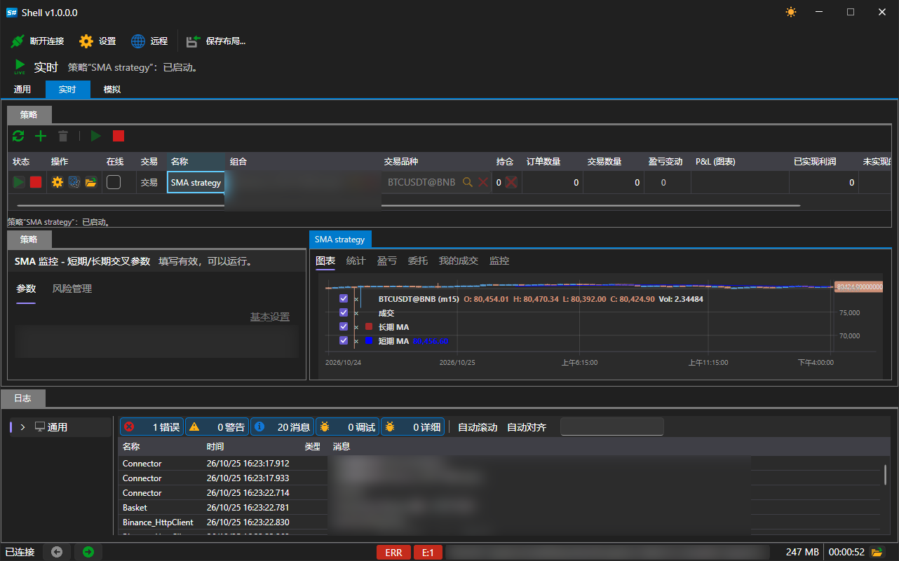

# 实盘

**实盘** 选项卡用于管理已启动用于交易的策略。

该区域由三部分组成：

- **策略** \- 顶部的表格，列出该区域的所有策略，并提供管理这些策略的按钮；
- **策略** \- 左侧的面板，显示所选策略的参数；
- 右侧的选项卡 \- **图表**、**统计**、**盈亏**、**委托** 和 **我的成交**：所选策略显示、提交和完成的全部内容。

只有在建立连接后才能使用该区域：未连接时按钮不可用，表格下方会显示相应提示。

## 按钮

| 按钮 | 作用 |
|---|---|
| **刷新** | 重新读取策略列表 |
| **添加** | 打开策略选择窗口 |
| **移除** | 从该区域中移除所选策略 |
| **开始** | 启动所选策略进行交易 |
| **停止** | 停止所选策略 |

## 策略表格

每一行表示一个策略。各列显示其状态和结果：

| 列 | 显示内容 |
|---|---|
| **状态** | 已停止、正在启动、正在运行、正在停止 |
| **操作** | 直接在行中启动、停止和平仓 |
| **在线** | 策略是否正在接收实时数据 |
| **交易** | 策略的交易模式 |
| **名称** | 添加时指定的名称 |
| **组合**、**交易品种** | 策略交易的对象 |
| **持仓** | 当前持仓 |
| **订单数量**、**交易数量** | 已提交的订单数量和已完成的成交数量 |
| **盈亏变动**、**P&L (图表)** | 盈亏及其变化 |
| **已实现利润**、**未实现的利润** | 结果中已平仓和未平仓的部分 |
| **错误** | 策略最近一次出现的错误（如果有） |

## 添加策略

**添加** 按钮会打开包含可用策略列表的窗口。

窗口中列出了自带的四个策略以及从 [Designer](../run_strategies_from_designer.md) 导入的所有策略图。**导入** 按钮可将从 Designer 导出的策略图添加到此列表；**新建** 按钮用于添加自定义策略的模板；**移除** 按钮会从列表中删除所选条目。

单击 **好的** 后，策略会显示在表格中，其参数会在 **策略** 面板上打开：交易品种、投资组合、数量、风险规则以及策略自己的参数，例如 **SMA 策略** 的移动平均线长度和K线时间周期。

## 推荐内容

[常规](common.md)

[模拟](emulation.md)
