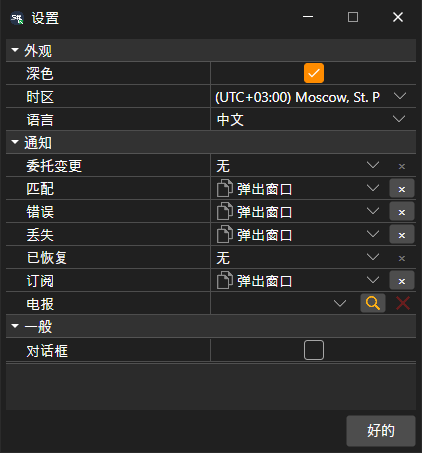

# 通用设置

**设置** 窗口可以通过[主菜单](../user_interface/ribbon.md)中的 **设置 → 设置** 项打开。其中的设置分为以下几组：

- **外观**：
  - **深色** — 深色界面主题；窗口标题栏中的按钮也可以切换该主题；
  - **时区** — 以哪个时区显示市场数据的时间；
  - **语言** — 程序语言。
- **一般**：
  - **对话框** — 显示程序自身未处理的错误窗口。如果取消勾选，此类错误只会写入日志。
- **通知** — 报告哪些订单和连接事件、采用何种方式报告，以及用于此类消息的 Telegram 频道。详细信息请参阅[通知](../notifications.md)。

单击 **好的** 后，界面主题会立即更改。语言和时区在重新启动后生效，因此 Terminal 会询问是否立即重新启动。

## 推荐内容

[重置设置](reset_settings.md)

[通知](../notifications.md)
