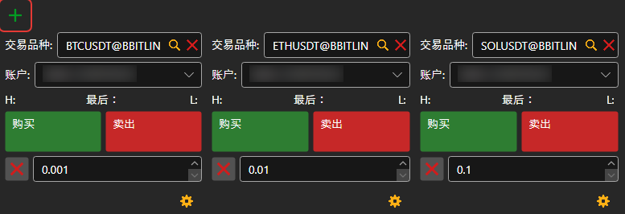
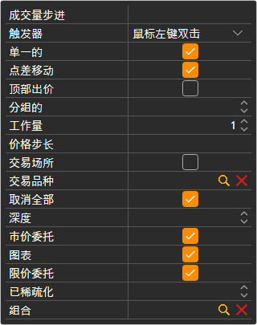

# 买入\/卖出

**买入/卖出** 组件是一组下单面板。每个下单面板显示一个交易品种的最优价格，并为所选投资组合提交该交易品种的订单。通过  按钮添加下单面板；首次连接时，面板会自动为交易场所的前几个交易品种创建下单面板。

## 下单面板设置

下单面板下方带齿轮图标的按钮会打开其设置：**交易品种**、**组合**、**工作量**、订单簿 **深度**，以及下单面板显示哪些区块：

- **限价委托** — 中间带价格字段的 **买** 和 **卖出** 按钮；价格字段旁边的按钮会将最优买价或卖价填入该字段；
- **市价委托** — 按市价执行的 **买**、**卖出**、**关闭持仓** 和 **反转仓位**；
- **取消全部** — 撤销下单面板所对应交易品种全部订单的按钮。

将[交易品种](instruments.md)中的行拖到下单面板上可以更换其交易品种；如果从[持仓](positions.md)中拖动行，下单面板会采用该行的交易品种和投资组合。

## 快捷键

当前打开的[工作区](../workspace.md)中 **买入/卖出** 面板的下单面板会响应以下按键：**F9** — 按市价买入，**F10** — 按市价卖出，**Esc** — 撤销所有订单。光标位于输入字段中时，这些按键不起作用。

> [!WARNING]
> **F9** 和 **F10** 会在不经确认的情况下向交易场所发送真实的市价订单。

## 推荐内容

[订单簿](order_book.md)

[Level 2](level_2.md)

[主菜单](../ribbon.md)
