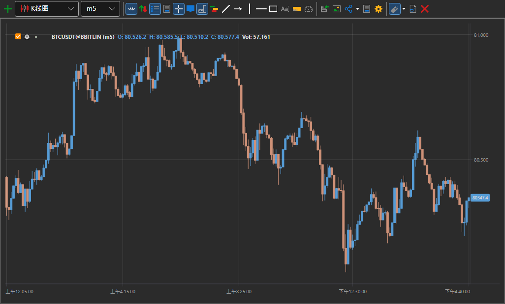
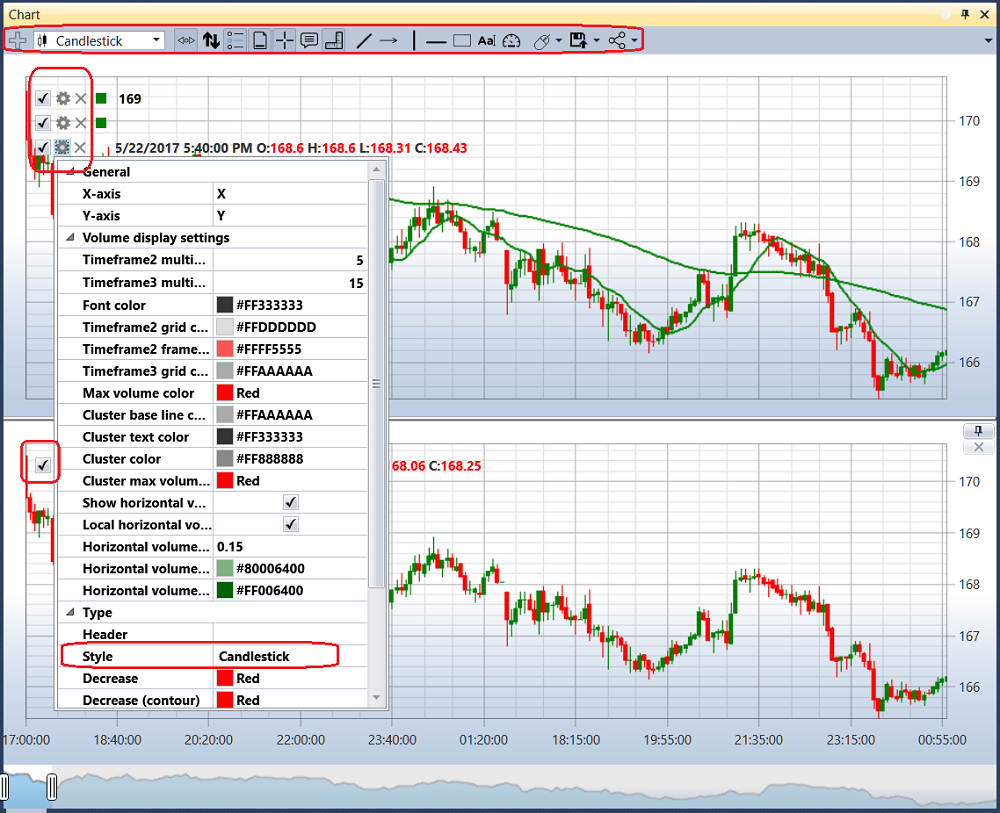
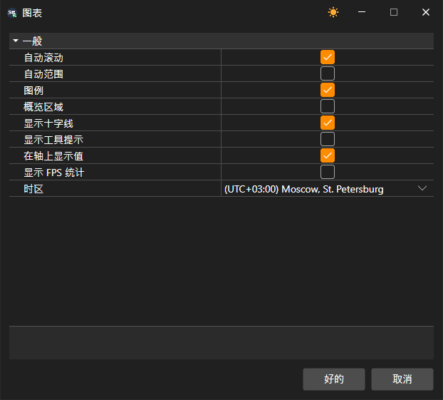

# 图表

**图表** 组件用于绘制所选交易品种的K线和指标。

要添加新的图表区域，请单击  按钮。

要向图表添加新元素，请右键单击图表区域中的任意位置并选择所需元素。可选元素包括K线、指标、订单和自有成交。

单击 ，然后单击  可打开图形元素的设置。

## 从图表交易

可以在图表上提交、移动和撤销订单。首先打开图表工具栏上的 **从图表提交委托** 开关，并在其下拉设置中指定 **交易品种**、**组合** 和订单数量。

- 按 **Ctrl+鼠标左键** 单击图表上的价格可提交买入订单，按 **Ctrl+鼠标右键** 可提交卖出订单。
- 自己的活动订单在图表上显示为其价格处的线。可以将该线拖到其他价格，订单会随之移动；线旁的叉号用于撤销订单。**取消委托** 按钮会撤销图表上的全部订单。
- **显示快速订单输入面板** 按钮会在图表上方显示一个面板，其中包含按最优买价 **卖出** 和按最优卖价 **买** 的按钮、两者之间的价差以及订单数量。可以将该面板拖到图表上的任意位置。

> [!WARNING]
> 从图表提交的订单会立即发送到交易场所，不经确认。

## 图表设置

图表工具栏上的 **设置** 按钮会打开整个图表的设置窗口：自动滚动和自动缩放、图例、查看区域、十字光标、工具提示、坐标轴上的值、FPS 统计以及时间轴标注所用的时区。

右键单击工具栏本身会打开其按钮列表：取消勾选可隐藏按钮，勾选可重新显示。显示哪些按钮会随图表一起保存。

**剪贴板图像** 按钮可以复制图表图片，以便粘贴到消息或文档中。右键单击图表元素会打开包含 **元素参数…** 和 **删除** 项的菜单；图表区域的菜单中有 **设置 → 图表区域…** 和 **删除面板**。也可以单击图表下方面板标题中的叉号关闭该面板。

可以使用 **←** 和 **→** 箭头键滚动图表，**Home** 和 **End** 键跳转到数据的开头和末尾，**+** 和 **−** 键调整缩放比例。

在图形元素设置中，可以选择所需的图表样式，例如日本K线、柱状图、箱形图、聚类轮廓图等。

对于箱形图，还可以对K线进行分组。分组顺序通过“第二时间周期倍数”和“第三时间周期倍数”字段设置。

图表上方设有工具栏，可以在其中选择自动滚动、自动缩放、图例模式以及其他通用图表设置。还可以选择要绘制到图表上的元素，包括线条、水平线、指针、矩形和文本。

## 推荐内容

[订单](../../../designer/user_interface/components/orders.md)
