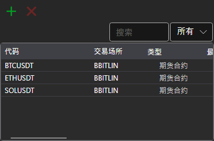

# 交易品种

**交易品种** 组件是一个交易品种表格，用于显示所有已选交易品种的信息。

要添加新的交易品种，请单击  按钮。随后会打开交易品种选择窗口：其中提供搜索功能，以及按交易品种类型和交易场所筛选的功能；加载交易品种列表时，表格下方会显示加载进度条。**删除交易品种** 按钮会从表格中删除所选交易品种。

在表格中选中的交易品种会显示在同一工作区的 **属性** 面板中。如果该区域的图表还没有用于提交订单的交易品种，所选交易品种将成为该交易品种。

可以用鼠标将交易品种行拖到该区域的其他面板（[买入/卖出](buy_sell.md)、[Level 1](level_1.md)、[Level 2](level_2.md)、[订单簿](order_book.md)或[图表](chart.md)），该面板会切换到此交易品种。

有关如何复制行、搜索和筛选行以及设置列，请参阅[使用表格](../tables.md)。

## 推荐内容

[Level 1](level_1.md)
