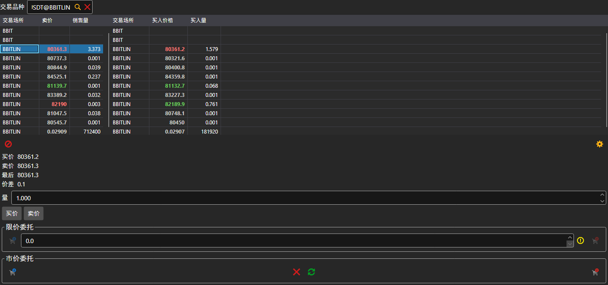

# Level 2

**Level 2** 组件同时显示某个交易品种在所有交易场所的报价：所有代码相同的交易品种都会出现在表格中，每个交易品种一行。左侧表格显示卖出方的最优价格和数量，右侧表格显示买入方的最优价格和数量。交易品种可以在表格上方的字段中选择，也可以从[交易品种](instruments.md)拖到面板上。

表格下方显示表格中所选行的买价、卖价、最新价和价差。**买价** 和 **卖价** 按钮会将相应价格填入限价订单；再往下是与[买入\/卖出](buy_sell.md)组件相同的下单面板：限价订单和市价订单。

## 推荐内容

[订单簿](order_book.md)

[买入\/卖出](buy_sell.md)
