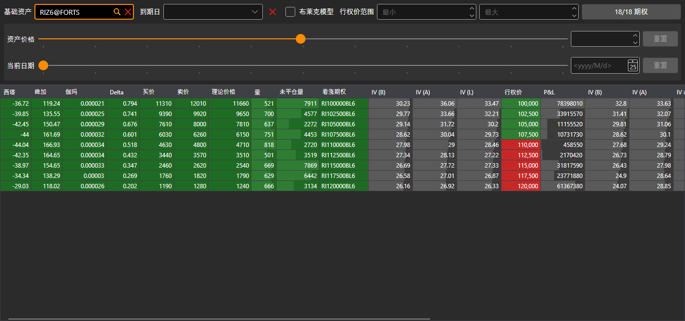

# 期权面板

**期权面板** 组件是一个表格，用于显示标的资产期权的主要参数：表格的每一行是一个执行价，左侧是看涨期权的参数，右侧是看跌期权的参数。

## 期权筛选器

表格上方有一个筛选器。所有期权组件（期权面板、[波动率微笑](smile_volatility.md)和[持仓（期权）](positions_options.md)）的筛选器都相同：

- **基础资产** — 显示其期权的交易品种；
- **到期日** — 只显示该到期日的期权；旁边的按钮用于清除筛选；
- **布莱克模型** — 按布莱克模型（用于期货期权）而不是布莱克-斯科尔斯模型计算理论价格、波动率和希腊字母指标；
- **行权价范围** — 最低和最高执行价；
- 带期权数量的按钮会打开标的资产的期权选择窗口。按钮上显示有多少已选期权通过了筛选，以及共选择了多少期权。

筛选器下方是“假设”计算。**资产价格** 滑块及其旁边的字段用于设置标的资产的另一个价格，**当前日期** 滑块和日历用于设置另一个当前日期。组件的计算基于这些值进行，**重置** 按钮会恢复实际价格和日期。

## 表格

“实值”执行价会高亮显示：对于看涨期权，是低于标的资产价格的执行价；对于看跌期权，是高于标的资产价格的执行价。

双击看涨或看跌期权的单元格会打开该期权的订单簿。

## 推荐内容

[波动率微笑](smile_volatility.md)
