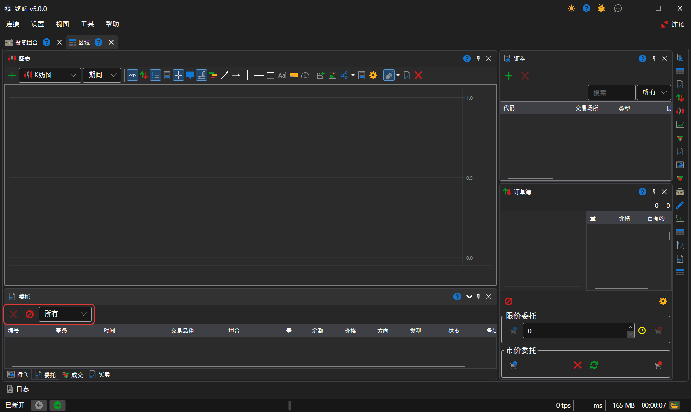
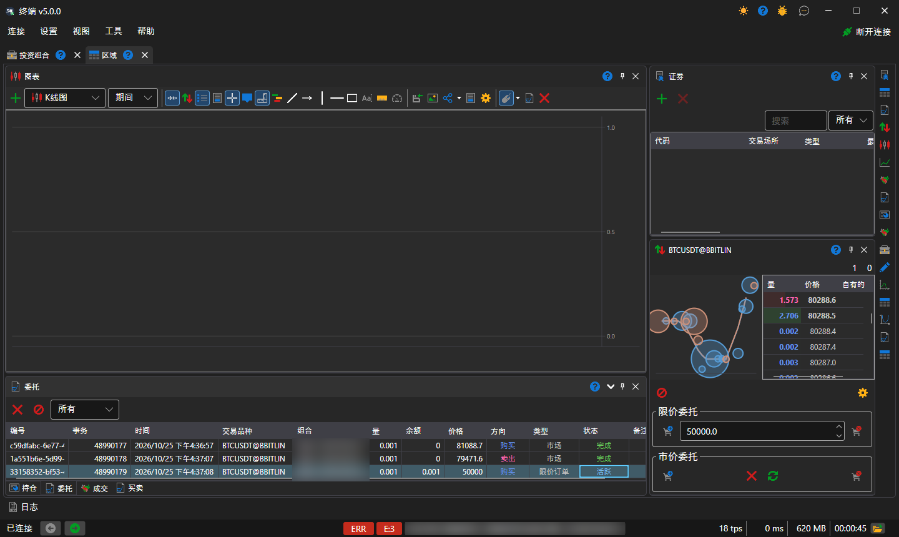
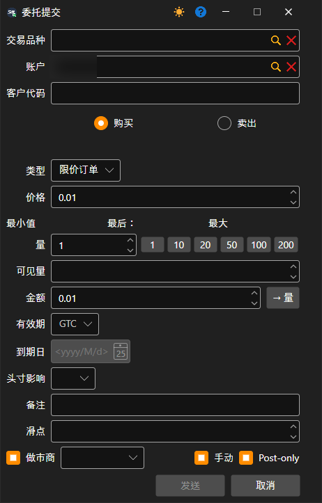
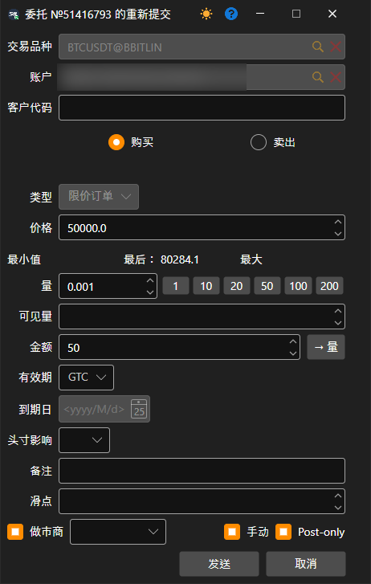

# 订单

**订单** 组件是一个订单表格，用于显示全部订单的详细信息。

表格上方有两个按钮：**取消** 用于撤销所选订单，**取消所有委托** 用于撤销全部活动订单。按钮旁边有一个列表，用于选择表格中显示哪些订单：全部、活动、已成交或被拒绝的订单。

右键单击某个订单时，会出现一个面板，可以通过该面板登记新订单、撤销订单或修改所选订单。

单击 **订单登记** 按钮后会出现一个窗口。要登记新订单，请填写该窗口并单击 **发送** 按钮。

单击 **修改订单** 按钮后会出现一个窗口。要修改订单，请完成所需更改并单击 **发送** 按钮。

## 推荐内容

[成交](../../../designer/user_interface/components/trades.md)
