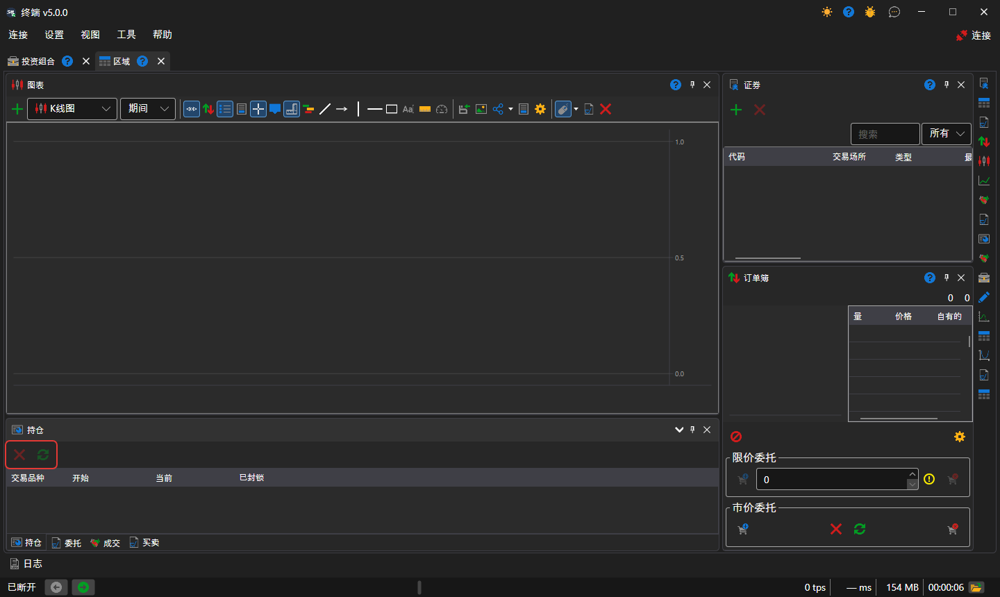

# 持仓

**持仓** 组件是按交易品种和投资组合列出当前持仓的表格：数量、平均价格以及盈亏。

表格上方有 **关闭持仓** 按钮（按市价提交订单，使所选持仓归零）和 **反转仓位** 按钮（按市价提交两倍持仓数量的订单，之后持仓规模不变但方向相反）。可以将持仓行拖到[买入\/卖出](buy_sell.md)下单面板上：下单面板会采用该行的交易品种和投资组合。

## 推荐内容

[持仓](../../../designer/user_interface/components/positions.md)

[买入\/卖出](buy_sell.md)
