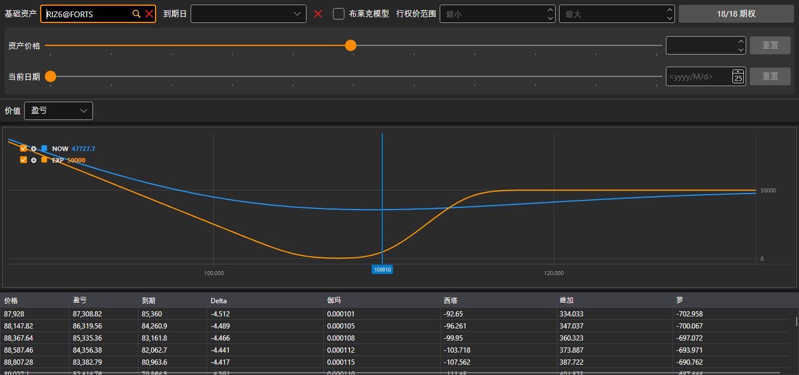

# 持仓（期权）

**持仓（期权）** 以图形方式显示期权持仓：持仓的指标如何随标的资产价格变化。

期权通过与[期权面板](option_desk.md)相同的筛选器选择：基础资产、到期日、执行价范围以及期权本身。筛选器下方的“假设”计算会显示标的资产价格不同、日期不同时的持仓情况。

在 **价值** 列表中选择要绘制的内容：**盈亏**、**Delta**、**伽玛**、**西塔**、**维加** 或 **罗**。图表下方是按标的资产价格列出的数值表：**价格**、当前盈亏、**到期** 时的盈亏以及希腊字母指标。

## 推荐内容

[期权面板](option_desk.md)
