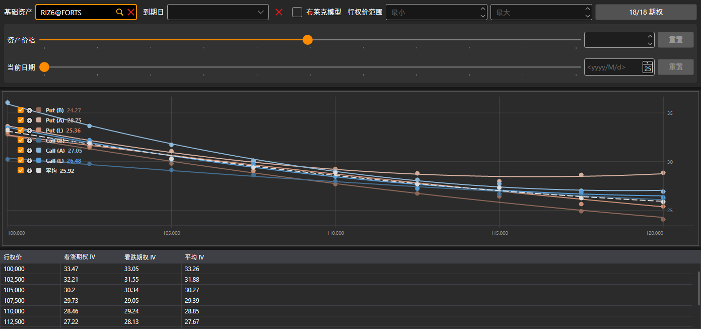

# 波动率微笑

**波动率微笑** 组件以图形方式显示具有相同标的资产、不同执行价的期权预期波动率水平。

期权通过与[期权面板](option_desk.md)相同的筛选器选择：基础资产、到期日、执行价范围以及期权本身。

图表上有七条曲线：按最优买价、最优卖价和最新成交价计算的看涨期权和看跌期权隐含波动率，以及以虚线表示的每个执行价上看涨期权和看跌期权波动率的 **平均**。图表下方是一个表格：**行权价**、**看涨期权** 和 **看跌期权** 的波动率（按最新成交价计算；如果没有成交，则按最优买价或卖价计算）及其 **平均**。

## 推荐内容

[期权面板](option_desk.md)

[持仓（期权）](positions_options.md)
