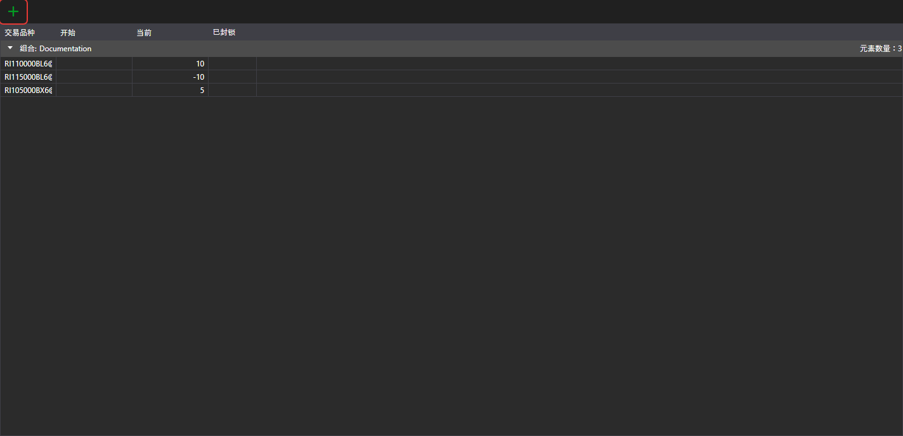

# 投资组合

**投资组合** 面板显示投资组合数据及相关持仓。可以通过[主菜单](ribbon.md)中的 **视图 → 投资组合** 项打开该面板。

 按钮用于创建持仓，其下拉菜单用于创建投资组合或持仓。双击行会打开该持仓进行编辑。

右键单击行会打开菜单，其中除[表格](tables.md)的通用项外，还包括：

- **编辑** — 打开持仓进行编辑；
- **关闭持仓** — 提交平仓的市价订单；
- **反转仓位** — 提交数量为持仓两倍的市价订单，使持仓方向反转；
- **提款** — 从交易场所提取资金：在窗口中指定提款数量和提款信息。仅当某资产的持仓为正且投资组合的连接支持提款时，该项才可用；
- **隐藏零余额** — 不显示余额为零的持仓。

有关投资组合、持仓及其编辑的详细信息，请参阅通用指南：[投资组合](../../designer/user_interface/portfolios.md)。
