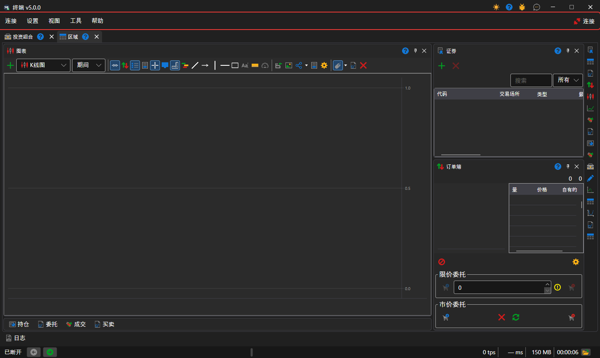
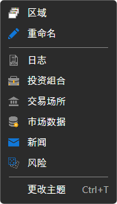

# 主菜单

[Terminal](../../terminal.md) 窗口标题下方是菜单栏：**连接**、**设置**、**视图**、**工具** 和 **帮助**。菜单栏末尾是 **连接** 按钮：它会将 Terminal 连接到所有[已配置的连接](../connection_settings.md)；连接建立后，该按钮的名称变为 **断开连接**。Terminal 处于连接状态时，连接设置和模拟器设置不可用。

窗口标题栏中最小化和关闭按钮的旁边，有切换界面主题、帮助、**报告问题** 和 **联系我们** 按钮。

## 菜单项

- **连接** — 连接和断开连接、[连接设置](../connection_settings.md)，以及模拟器设置（模拟器使用真实市场数据执行订单，但不会将订单发送到交易场所）。
- **设置** — 程序的[通用设置](../settings/common_settings.md)；**保存布局** 和 **重置布局**（将面板恢复到初始位置）；[重置设置](../settings/reset_settings.md)；**交易品种和连接** 与 **投资组合和连接** 窗口，用于为交易品种或投资组合指定其交易所用的连接。
- **视图** — 新建[工作区](workspace.md)（**区域**）和重命名当前工作区（**重命名**）；整个窗口的面板：[日志](logs.md)、[投资组合](portfolios.md)、[交易板编辑器](board_editor.md)、**市场数据**、[新闻](components/news.md)、[风险](risk_management.md)；切换界面主题。
- **工具** — **创建新交易品种**、由多个交易品种组成的 **新建指数合约**，以及由不同期限期货组成的 **连续交易品种**；创建的交易品种会立即显示在当前打开区域的[交易品种](components/instruments.md)中。
- **帮助** — **文档**、**错误报告**、联系 StockSharp 团队以及 **关于程序** 窗口。

## 快捷键

| 按键 | 操作 |
|---|---|
| **F5** | 连接或断开连接 |
| **Ctrl+,** | 连接设置 |
| **Ctrl+S** | 保存布局 |
| **Ctrl+T** | 切换界面主题 |
| **F1** | 打开帮助 |
| **Alt+C**、**Alt+S**、**Alt+V**、**Alt+T**、**Alt+H** | 打开 **连接**、**设置**、**视图**、**工具**、**帮助** 菜单 |
| **F9** | 在活动的[买入/卖出](components/buy_sell.md)下单面板中按市价买入 |
| **F10** | 在活动的下单面板中按市价卖出 |
| **Esc** | 撤销活动下单面板的所有订单 |

活动下单面板是指当前打开的工作区中 **买入/卖出** 面板的下单面板。光标位于输入字段中时，**F9**、**F10** 和 **Esc** 键不起作用。

> [!WARNING]
> **F9** 和 **F10** 会在不经确认的情况下向交易场所发送真实的市价订单。

## 推荐内容

[工作区](workspace.md)

[组件](components.md)
