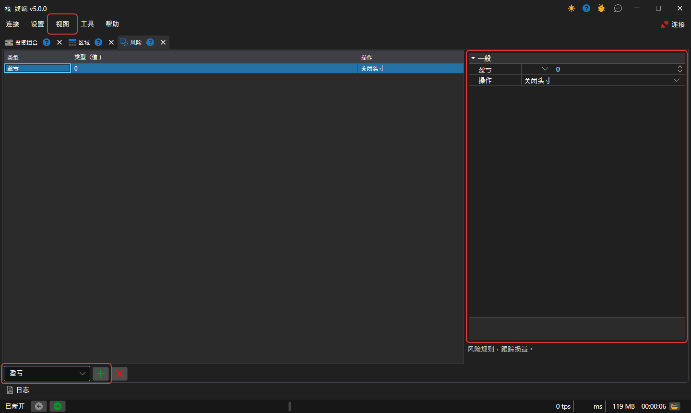

# 风险管理

可以在 **风险** 面板中配置风险控制设置。可以通过[主菜单](ribbon.md)中的 **视图 → 风险** 项打开该面板。

要添加 **风险规则**，请在表格下方的列表中选择其类型，然后单击 **添加规则** 按钮。规则会显示在表格中，右侧显示其设置：**风险规则** 的触发条件，以及条件满足时要执行的操作（平仓、停止交易、撤销订单）。设置下方显示所选规则的说明。**删除规则** 按钮会删除所选规则。

规则由 Terminal 的连接负责检查，检查对象是经由该连接的订单、成交和投资组合数据。规则集合会在程序重新启动后保留。

有关风险规则列表及其说明，请参阅[风险管理](../../designer/user_interface/risk_management.md)。
