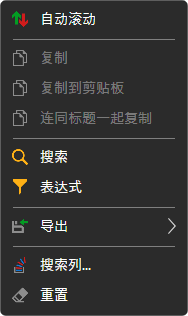
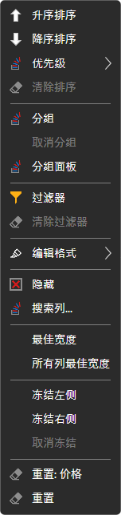

# 使用表格

[Terminal](../../terminal.md) 所有面板中的表格（交易品种、订单、成交、持仓、投资组合、Level 1、订单日志、新闻）都采用相同的结构。

## 表格菜单

右键单击表格行会打开菜单：

- **自动滚动** — 表格自动滚动到新行；
- **复制**、**复制到剪贴板** — 将所选行复制到剪贴板：可见列按显示顺序以制表符分隔，表格的每一行对应一行文本。**连同标题一起复制** 会在第一行添加列名。**Ctrl+C** 的作用与 **复制** 相同；
- **搜索**（**Ctrl+F**）— 在表格中搜索文本。可以选择在哪些列中搜索；**以前的** 和 **下一个** 按钮用于在找到的单元格之间跳转，**清除** 用于重置搜索；
- **表达式** — 以公式形式按列值条件筛选行，例如 `=[Price] > 100`。该字段会提示列名和函数（`CONTAINS`、`STARTSWITH`、`ENDSWITH`、`TODAY`、`NOW` 等），立即显示公式中的错误，**预览** 会显示公式对所选行的结果。**应用** 启用筛选，**清除过滤器** 取消筛选；
- **导出** — 将表格导出到剪贴板（CSV 格式文本或图片），或导出为 CSV、Excel 或 PNG 文件。**分享图片链接** 会将表格图片上传到 StockSharp 网站并复制其链接，为此需要登录网站。**打印** 会在浏览器中打开表格，可以从浏览器打印；
- **搜索列...** — 用于显示和隐藏列的窗口；
- **重置** — 将表格恢复为初始外观。

## 列菜单

右键单击列标题会打开该列的菜单：

- **升序排序**、**降序排序**、**清除排序**。单击列标题也会按该列对表格排序。**优先级** 会在已设置的排序之外添加按该列排序，从而同时按多列排序；
- **分组** — 按列值对行分组，**取消分组**。**分组面板** 显示分组层级：可以从列表中添加列，也可以拖动列标题将其拖到面板上，层级可以调整顺序，每个层级都有自己的排序方向；
- **过滤器** — 按该列的值筛选行，**清除过滤器**；
- **编辑格式** — 用于以颜色突出显示该列单元格的规则：**添加规则**，规则可以编辑、禁用或删除；
- **隐藏** — 隐藏该列，**搜索列...** — 重新显示该列；
- 列的 **最佳宽度** 和 **所有列最佳宽度** — 按内容调整宽度；
- **冻结左侧**、**冻结右侧**、**取消冻结** — 冻结的列在表格横向滚动时保持不动；
- **重置** 该列或整个表格。

表格的外观（显示哪些列、列的顺序和宽度）会与窗口布局一起保存。

## 推荐内容

[工作区](workspace.md)

[组件](components.md)
