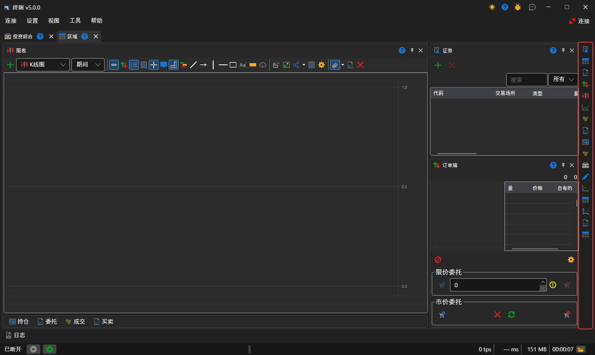
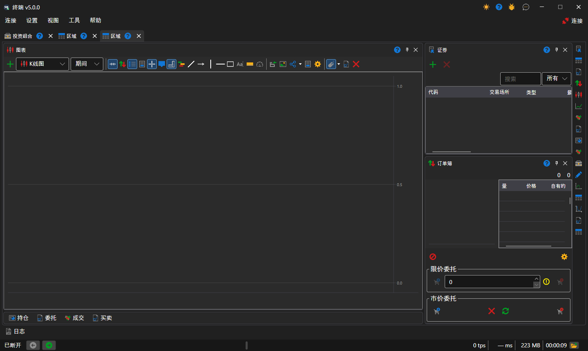

# 工作区

工作区是 [Terminal](../../terminal.md) 窗口中的一个选项卡，拥有自己的一组面板：图表、表格、下单面板。工作区的数量不限，每个工作区都独立运行：在一个工作区中选择的交易品种不会改变另一个工作区的面板。

可以通过[主菜单](ribbon.md)中的 **视图 → 区域** 项新建工作区，通过 **视图 → 重命名** 项重命名当前工作区。

## 工作区的面板

面板通过工作区右边缘竖栏中的按钮添加，每个[组件](components.md)对应一个按钮。每次单击都会再打开一个该类型的面板，因此一个工作区中可以有多个面板，例如两个不同交易品种的图表。可以拖动面板标题将其移到工作区中的其他位置、停靠到相邻面板的边缘、与相邻面板合并为选项卡，或者移到单独的窗口中。

## 新工作区的布局

新工作区采用交易终端中常见的布局：图表位于中央并占据整个高度，右侧是[交易品种](components/instruments.md)，其下方是[订单簿](components/order_book.md)，而 **持仓**、**委托**、**我的成交** 表格和 **买入/卖出** 下单面板折叠在图表下方的一排选项卡中。单击选项卡会展开表格，单击表格标题中的按钮可将其重新折叠。表格是否折叠，Terminal 会与面板的位置一起记住。

每次更改后，Terminal 都会自动保存面板的布局；**设置 → 保存布局**（Ctrl+S）会立即保存布局，而 **设置 → 重置布局** 会将面板恢复到初始位置。

## 推荐内容

[主菜单](ribbon.md)

[组件](components.md)
